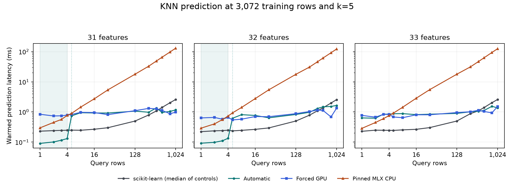

# Warmed KNN prediction across the 32-feature gate on M5 Pro

At 3,072 training rows and k=5, **automatic mode used CPU through four queries at 31 and 32 features, and used GPU from the first query at 33**. The Metal traces verified each route. One-query automatic latency was 0.090 ms at 31 features, 0.092 ms at 32, and 0.634 ms at 33. In the 33-feature case the paired scikit-learn control took 0.228 ms and pinned MLX CPU took 0.286 ms.

| Features | First auto GPU batch | First forced-GPU two-pass win vs pinned MLX CPU | First auto-GPU two-pass win vs pinned MLX CPU | First batch where both GPU modes won both passes vs scikit-learn |
|---:|---:|---:|---:|---:|
| 31 | 5 | 8 | 8 | 512 |
| 32 | 5 | 4 | 5 | 768 |
| 33 | 1 | 5 | 8 | 512 |

A two-pass win requires a lower median than the corresponding CPU baseline in both passes. Against pinned CPU, forced GPU had a split result at five queries for 31 features and at three queries for 32 features. At 33 features, forced GPU lost both passes at four queries and won both at five. Auto GPU split at five for 31 and 33 features, then won at eight. Sizes between the tested points remain unresolved. The latency crossover did not move monotonically with width in these runs.

The pinned routing rule admits the small CPU query when features and k are both at most 32, query rows are at most four, and the training/query product is at most 16,384. The separate 33–64-feature CPU path requires at most 2,048 training rows. All cases here have 3,072 training rows, so at 33 features the small-query CPU routes do not apply. [Pinned routing source](https://github.com/tabulai/mlx-learn/blob/v0.1.2/src/mlxlearn/_kernels/distance.py#L151-L175)

A follow-up reuses the exact 32-feature inputs and [varies k across 31, 32 and 33](../knn-neighbor-sweep/README.md).

## Workload and timing design

A single seed-42, 16,384-row synthetic binary dataset provides 33 source columns and a fixed 75/25 split. The same 3,072 training rows and the same query prefixes are used across widths. Cases take the first 31, 32, or 33 columns. Shared standardized columns, labels, and row order are byte-identical. Scaling is fitted on those 3,072 training rows. This creates a new shared-source 32-feature reference, distinct from the earlier [training-size sweep](../knn-training-sweep/README.md). All modes use five neighbors, Euclidean distance and uniform voting.

The 14 query sizes span 1–1,024 rows. Uninstrumented blocks run auto → forced GPU → pinned MLX CPU → pinned MLX CPU → forced GPU → auto. Each block requests four CPU threads and includes a fresh scikit-learn control. Per case and implementation, one fit is followed by the first prediction, one extra warmup, and 15 steady predictions on the same fitted model. Only the steady calls feed the medians below. All 3,780 steady timing pairs passed numerical checks.

The prediction table reports milliseconds as the median of two block medians. The three scikit-learn columns are the associated controls for auto, forced GPU and pinned CPU. GPU wins count the block medians faster than the corresponding CPU baseline in that pass. Auto's small-query CPU results are labeled CPU in the wins columns. The modes use distinct available search paths within mlx-learn, and the scikit-learn comparison uses its own CPU implementation.



The shaded regions show batches that auto routed to the CPU. The chart summarizes the three scikit-learn controls as a single median. The tables retain each paired control separately.

## Prediction timings

### 31 features

| Query rows | scikit-learn, auto / forced / CPU blocks | Auto | Forced GPU | MLX CPU | GPU wins vs MLX CPU, auto / forced | GPU wins vs scikit-learn, auto / forced |
|---:|---:|---:|---:|---:|---:|---:|
| 1 | 0.237 / 0.224 / 0.230 | 0.090 | 0.838 | 0.296 | CPU / 0/2 | CPU / 0/2 |
| 2 | 0.238 / 0.240 / 0.241 | 0.101 | 0.736 | 0.449 | CPU / 0/2 | CPU / 0/2 |
| 3 | 0.250 / 0.245 / 0.241 | 0.116 | 0.745 | 0.567 | CPU / 0/2 | CPU / 0/2 |
| 4 | 0.247 / 0.247 / 0.247 | 0.131 | 0.784 | 0.766 | CPU / 0/2 | CPU / 0/2 |
| 5 | 0.250 / 0.244 / 0.255 | 0.741 | 0.826 | 0.892 | 1/2 / 1/2 | 0/2 / 0/2 |
| 8 | 0.247 / 0.244 / 0.247 | 0.943 | 0.970 | 1.450 | 2/2 / 2/2 | 0/2 / 0/2 |
| 16 | 0.268 / 0.267 / 0.261 | 0.925 | 0.953 | 2.726 | 2/2 / 2/2 | 0/2 / 0/2 |
| 32 | 0.300 / 0.314 / 0.296 | 0.920 | 0.815 | 5.396 | 2/2 / 2/2 | 0/2 / 0/2 |
| 128 | 0.492 / 0.501 / 0.498 | 1.064 | 1.102 | 17.850 | 2/2 / 2/2 | 0/2 / 0/2 |
| 256 | 0.790 / 0.789 / 0.818 | 0.979 | 1.310 | 32.774 | 2/2 / 2/2 | 0/2 / 0/2 |
| 384 | 1.085 / 1.083 / 1.079 | 1.357 | 1.273 | 49.243 | 2/2 / 2/2 | 0/2 / 1/2 |
| 512 | 1.349 / 1.413 / 1.427 | 0.961 | 1.129 | 65.654 | 2/2 / 2/2 | 2/2 / 2/2 |
| 768 | 2.053 / 2.023 / 2.015 | 1.045 | 0.869 | 97.805 | 2/2 / 2/2 | 2/2 / 2/2 |
| 1024 | 2.600 / 2.593 / 2.587 | 1.167 | 0.986 | 130.888 | 2/2 / 2/2 | 2/2 / 2/2 |

### 32 features

| Query rows | scikit-learn, auto / forced / CPU blocks | Auto | Forced GPU | MLX CPU | GPU wins vs MLX CPU, auto / forced | GPU wins vs scikit-learn, auto / forced |
|---:|---:|---:|---:|---:|---:|---:|
| 1 | 0.224 / 0.218 / 0.222 | 0.092 | 0.633 | 0.289 | CPU / 0/2 | CPU / 0/2 |
| 2 | 0.236 / 0.237 / 0.231 | 0.098 | 0.659 | 0.402 | CPU / 0/2 | CPU / 0/2 |
| 3 | 0.253 / 0.235 / 0.240 | 0.111 | 0.572 | 0.559 | CPU / 1/2 | CPU / 0/2 |
| 4 | 0.262 / 0.248 / 0.237 | 0.134 | 0.665 | 0.732 | CPU / 2/2 | CPU / 0/2 |
| 5 | 0.264 / 0.235 / 0.234 | 0.617 | 0.543 | 0.930 | 2/2 / 2/2 | 0/2 / 0/2 |
| 8 | 0.245 / 0.244 / 0.248 | 0.812 | 0.575 | 1.419 | 2/2 / 2/2 | 0/2 / 0/2 |
| 16 | 0.254 / 0.273 / 0.264 | 0.765 | 0.704 | 2.776 | 2/2 / 2/2 | 0/2 / 0/2 |
| 32 | 0.295 / 0.297 / 0.292 | 0.638 | 0.696 | 5.426 | 2/2 / 2/2 | 0/2 / 0/2 |
| 128 | 0.500 / 0.499 / 0.500 | 0.825 | 0.879 | 17.772 | 2/2 / 2/2 | 0/2 / 0/2 |
| 256 | 0.767 / 0.785 / 0.781 | 0.975 | 1.035 | 30.854 | 2/2 / 2/2 | 0/2 / 0/2 |
| 384 | 1.103 / 1.085 / 1.090 | 1.303 | 1.156 | 46.121 | 2/2 / 2/2 | 0/2 / 1/2 |
| 512 | 1.356 / 1.372 / 1.396 | 1.481 | 1.122 | 61.658 | 2/2 / 2/2 | 0/2 / 1/2 |
| 768 | 1.977 / 2.009 / 1.977 | 1.523 | 0.684 | 91.991 | 2/2 / 2/2 | 2/2 / 2/2 |
| 1024 | 2.559 / 2.549 / 2.565 | 1.644 | 1.333 | 122.996 | 2/2 / 2/2 | 2/2 / 2/2 |

### 33 features

| Query rows | scikit-learn, auto / forced / CPU blocks | Auto | Forced GPU | MLX CPU | GPU wins vs MLX CPU, auto / forced | GPU wins vs scikit-learn, auto / forced |
|---:|---:|---:|---:|---:|---:|---:|
| 1 | 0.228 / 0.225 / 0.264 | 0.634 | 0.768 | 0.286 | 0/2 / 0/2 | 0/2 / 0/2 |
| 2 | 0.246 / 0.249 / 0.248 | 0.621 | 0.671 | 0.447 | 1/2 / 0/2 | 0/2 / 0/2 |
| 3 | 0.278 / 0.247 / 0.245 | 0.847 | 0.832 | 0.600 | 0/2 / 0/2 | 0/2 / 0/2 |
| 4 | 0.241 / 0.245 / 0.247 | 0.842 | 0.827 | 0.754 | 0/2 / 0/2 | 0/2 / 0/2 |
| 5 | 0.251 / 0.240 / 0.244 | 0.873 | 0.681 | 0.916 | 1/2 / 2/2 | 0/2 / 0/2 |
| 8 | 0.275 / 0.254 / 0.252 | 0.879 | 0.644 | 1.431 | 2/2 / 2/2 | 0/2 / 0/2 |
| 16 | 0.260 / 0.267 / 0.265 | 0.815 | 0.804 | 2.849 | 2/2 / 2/2 | 0/2 / 0/2 |
| 32 | 0.302 / 0.292 / 0.312 | 0.843 | 0.805 | 5.507 | 2/2 / 2/2 | 0/2 / 0/2 |
| 128 | 0.500 / 0.530 / 0.499 | 0.895 | 0.955 | 17.905 | 2/2 / 2/2 | 0/2 / 0/2 |
| 256 | 0.879 / 0.999 / 0.787 | 1.012 | 1.016 | 31.357 | 2/2 / 2/2 | 0/2 / 1/2 |
| 384 | 1.087 / 1.070 / 1.096 | 1.055 | 1.137 | 46.822 | 2/2 / 2/2 | 1/2 / 0/2 |
| 512 | 1.396 / 1.366 / 1.451 | 1.116 | 1.038 | 62.587 | 2/2 / 2/2 | 2/2 / 2/2 |
| 768 | 2.002 / 2.027 / 2.028 | 1.537 | 0.934 | 94.073 | 2/2 / 2/2 | 2/2 / 2/2 |
| 1024 | 2.621 / 2.590 / 2.579 | 1.364 | 1.505 | 125.574 | 2/2 / 2/2 | 2/2 / 2/2 |

## Independent Metal evidence

Separate command-completion replays cover all 42 query/feature shapes in all three mlx-learn modes. Each prediction trace follows two predictions on the same fitted model. Every forced prediction submitted GPU work. Auto submitted no Metal buffers through four rows at 31 and 32 features and submitted GPU work from five rows onward. At 33 features every auto prediction submitted GPU work. All pinned CPU predictions, scikit-learn controls, and fit windows submitted zero Metal buffers. All 126 traced comparisons passed numerical checks. The traces retain operation-scoped Metal start and end timestamps, backend events and input fingerprints. [Apple Metal GPU timestamps](https://developer.apple.com/documentation/metal/mtlcommandbuffer/gpustarttime)

- [31 features, one query](metal/auto-d31-q1/metadata.json)
- [32 features, four queries](metal/auto-d32-q4/metadata.json) and [five queries](metal/auto-d32-q5/metadata.json)
- [33 features, one query](metal/auto-d33-q1/metadata.json)
- [All trace directories](metal/)

## Raw data and reproduction

[Comparison JSON](comparison.json) contains block medians and dispersion, ratios against scikit-learn, and per-pass ratios against pinned MLX CPU. Each [timing run](runs/) retains its manifest, raw measurement rows and run summaries.

Run timing first, then tracing, with the locked Apple Silicon environment and fresh output directories.

```sh
config=scripts/knn-feature-sweep.yaml
.venv/bin/python scripts/benchmark_routing.py results/knn-feature-timing-replay \
  --config "$config" --with-mlx-cpu
.venv/bin/python scripts/summarize_routing.py results/knn-feature-timing-replay/*

out=results/knn-feature-metal-replay
mkdir -p "$out"
xcrun clang -dynamiclib -fobjc-arc -framework Foundation -framework Metal \
  scripts/metal_command_trace.m -o "$out/probe.dylib"
for mode in cpu auto forced; do
  if [ "$mode" = forced ]; then export MLXLEARN_FORCE_BACKEND=mlx; else unset MLXLEARN_FORCE_BACKEND; fi
  for d in 31 32 33; do
    for q in 1 2 3 4 5 8 16 32 128 256 384 512 768 1024; do
      tag="$mode-d$d-q$q"
      MTL_CAPTURE_ENABLED=1 VECLIB_MAXIMUM_THREADS=4 OMP_NUM_THREADS=4 \
        .venv/bin/python scripts/trace_fit_inference.py "knn-16384x${d}-c2-k5-t3072-s33-q$q" \
        "$out/$tag" "$out/probe.dylib" --mode "$mode" --reuse-model \
        --config "$config" --completion-only > "$out/$tag.json"
    done
  done
done
unset MLXLEARN_FORCE_BACKEND
```
