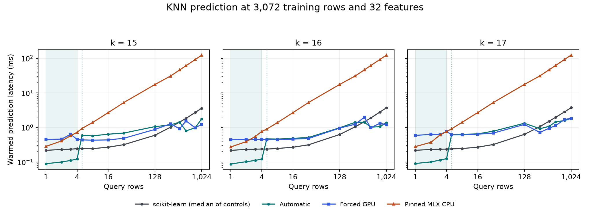

# Warmed KNN across the fused GPU search cutoff on M5 Pro

At 3,072 training rows and 32 features, the operation-scoped dispatch traces verified the fused screen path for **k=15 and k=16** and the general Gram search for **k=17**. All three k values routed automatically to CPU through four queries and GPU from five. The k=16 limit governs the GPU search implementation, while the small-query auto rule still allows the host through k=32. [Pinned device search source](https://github.com/tabulai/mlx-learn/blob/v0.1.2/src/mlxlearn_device/_neighbors.py) · [Pinned auto routing source](https://github.com/tabulai/mlx-learn/blob/v0.1.2/src/mlxlearn/_kernels/distance.py#L151-L175)

| Neighbors | Verified GPU search | First auto GPU batch | First forced-GPU two-pass win vs pinned MLX CPU | First auto-GPU two-pass win vs pinned MLX CPU | First batch where both GPU modes beat scikit-learn in both passes |
|---:|---|---:|---:|---:|---:|
| 15 | Fused screen | 5 | 4 | 5 | 768 |
| 16 | Fused screen | 5 | 3 | 5 | 512 |
| 17 | General Gram and candidate certification | 5 | 5 | 5 | 384 |

A two-pass win means the median beat its corresponding CPU median in both passes. Against scikit-learn, at k=15 forced GPU won both passes at 384 queries but did not repeat the win in both passes at 512. Both modes won together at 768 and 1,024. For k=17 both won together at 384 and every larger tested size. The latency bounds are specific to these batches and blocks.

The kernel switch did not yield a uniform latency shift. Forced GPU at k=16 versus k=17 took 1.241 versus 0.716 ms at 256 queries and 1.206 versus 1.833 ms at 1,024. These compare different k values on the same arrays, each with its own result and parity check.

## Workload and timing design

Every case reuses the same 3,072 training rows and the same 32 standardized columns as the [32-feature reference](../knn-feature-sweep/README.md). The case generator uses the same seed-42 16,384-row source and selects the same 32 of the original 33 columns. Query batches are the identical prefixes of the held-out split, and each input fingerprint matches the corresponding k=5 case. Only k changes within each query size. All modes use Euclidean distance and uniform voting. Parity is checked against scikit-learn at the same k.

The 14 query sizes span 1–1,024 rows. Uninstrumented blocks run auto → forced GPU → pinned MLX CPU → pinned MLX CPU → forced GPU → auto. Each block requests four CPU threads and includes a fresh scikit-learn control. Per case and implementation, one fit is followed by a first prediction, one extra warmup, and 15 steady predictions on the same fitted model. Only the steady calls feed latency medians. All 3,780 steady timing pairs passed numerical checks.

The prediction tables report milliseconds as the median of two block medians. The three scikit-learn values are paired controls for auto, forced GPU and pinned CPU. The wins columns count the blocks in which the candidate GPU median beat the named CPU baseline in the same pass. Auto's host results are marked CPU. The fixed MLX CPU path and auto's low-latency host path are distinct implementations.



Shading marks automatic CPU routing. The plot uses the median of the three scikit-learn controls. The tables retain the separate paired controls.

## Prediction timings

### k = 15

| Query rows | scikit-learn, auto / forced / CPU blocks | Auto | Forced GPU | MLX CPU | GPU wins vs MLX CPU, auto / forced | GPU wins vs scikit-learn, auto / forced |
|---:|---:|---:|---:|---:|---:|---:|
| 1 | 0.217 / 0.222 / 0.217 | 0.089 | 0.449 | 0.283 | CPU / 0/2 | CPU / 0/2 |
| 2 | 0.230 / 0.232 / 0.230 | 0.100 | 0.459 | 0.406 | CPU / 0/2 | CPU / 0/2 |
| 3 | 0.235 / 0.234 / 0.248 | 0.111 | 0.633 | 0.575 | CPU / 1/2 | CPU / 0/2 |
| 4 | 0.244 / 0.238 / 0.243 | 0.122 | 0.451 | 0.725 | CPU / 2/2 | CPU / 0/2 |
| 5 | 0.246 / 0.242 / 0.243 | 0.592 | 0.436 | 0.939 | 2/2 / 2/2 | 0/2 / 0/2 |
| 8 | 0.243 / 0.245 / 0.243 | 0.571 | 0.428 | 1.393 | 2/2 / 2/2 | 0/2 / 0/2 |
| 16 | 0.268 / 0.271 / 0.268 | 0.637 | 0.435 | 2.685 | 2/2 / 2/2 | 0/2 / 0/2 |
| 32 | 0.318 / 0.311 / 0.317 | 0.688 | 0.485 | 5.248 | 2/2 / 2/2 | 0/2 / 0/2 |
| 128 | 0.643 / 0.594 / 0.591 | 1.056 | 0.876 | 17.453 | 2/2 / 2/2 | 0/2 / 0/2 |
| 256 | 1.016 / 1.026 / 0.990 | 1.182 | 1.270 | 30.706 | 2/2 / 2/2 | 0/2 / 0/2 |
| 384 | 1.425 / 1.422 / 1.438 | 1.421 | 0.915 | 46.028 | 2/2 / 2/2 | 1/2 / 2/2 |
| 512 | 1.867 / 1.833 / 1.814 | 0.795 | 1.548 | 61.333 | 2/2 / 2/2 | 2/2 / 1/2 |
| 768 | 2.747 / 2.703 / 2.716 | 0.980 | 0.972 | 92.035 | 2/2 / 2/2 | 2/2 / 2/2 |
| 1024 | 3.573 / 3.571 / 3.559 | 1.756 | 1.229 | 123.069 | 2/2 / 2/2 | 2/2 / 2/2 |

### k = 16

| Query rows | scikit-learn, auto / forced / CPU blocks | Auto | Forced GPU | MLX CPU | GPU wins vs MLX CPU, auto / forced | GPU wins vs scikit-learn, auto / forced |
|---:|---:|---:|---:|---:|---:|---:|
| 1 | 0.218 / 0.217 / 0.216 | 0.088 | 0.440 | 0.273 | CPU / 0/2 | CPU / 0/2 |
| 2 | 0.234 / 0.231 / 0.232 | 0.102 | 0.450 | 0.388 | CPU / 0/2 | CPU / 0/2 |
| 3 | 0.235 / 0.237 / 0.233 | 0.111 | 0.452 | 0.550 | CPU / 2/2 | CPU / 0/2 |
| 4 | 0.238 / 0.242 / 0.236 | 0.123 | 0.450 | 0.768 | CPU / 2/2 | CPU / 0/2 |
| 5 | 0.236 / 0.238 / 0.236 | 0.468 | 0.441 | 0.900 | 2/2 / 2/2 | 0/2 / 0/2 |
| 8 | 0.246 / 0.245 / 0.246 | 0.462 | 0.439 | 1.379 | 2/2 / 2/2 | 0/2 / 0/2 |
| 16 | 0.267 / 0.264 / 0.268 | 0.483 | 0.460 | 2.681 | 2/2 / 2/2 | 0/2 / 0/2 |
| 32 | 0.309 / 0.323 / 0.314 | 0.512 | 0.479 | 5.267 | 2/2 / 2/2 | 0/2 / 0/2 |
| 128 | 0.624 / 0.625 / 0.617 | 0.978 | 0.958 | 17.537 | 2/2 / 2/2 | 0/2 / 0/2 |
| 256 | 1.049 / 1.023 / 1.047 | 1.410 | 1.241 | 30.869 | 2/2 / 2/2 | 0/2 / 0/2 |
| 384 | 1.456 / 1.438 / 1.481 | 1.415 | 1.966 | 46.235 | 2/2 / 2/2 | 1/2 / 0/2 |
| 512 | 1.855 / 1.910 / 1.878 | 1.017 | 0.984 | 61.875 | 2/2 / 2/2 | 2/2 / 2/2 |
| 768 | 2.791 / 2.767 / 2.788 | 1.059 | 1.322 | 92.615 | 2/2 / 2/2 | 2/2 / 2/2 |
| 1024 | 3.713 / 3.637 / 3.683 | 1.373 | 1.206 | 123.678 | 2/2 / 2/2 | 2/2 / 2/2 |

### k = 17

| Query rows | scikit-learn, auto / forced / CPU blocks | Auto | Forced GPU | MLX CPU | GPU wins vs MLX CPU, auto / forced | GPU wins vs scikit-learn, auto / forced |
|---:|---:|---:|---:|---:|---:|---:|
| 1 | 0.217 / 0.222 / 0.218 | 0.091 | 0.588 | 0.280 | CPU / 0/2 | CPU / 0/2 |
| 2 | 0.231 / 0.233 / 0.230 | 0.101 | 0.631 | 0.372 | CPU / 0/2 | CPU / 0/2 |
| 3 | 0.234 / 0.234 / 0.234 | 0.114 | 0.626 | 0.608 | CPU / 1/2 | CPU / 0/2 |
| 4 | 0.242 / 0.237 / 0.236 | 0.125 | 0.768 | 0.758 | CPU / 1/2 | CPU / 0/2 |
| 5 | 0.243 / 0.239 / 0.240 | 0.612 | 0.610 | 0.911 | 2/2 / 2/2 | 0/2 / 0/2 |
| 8 | 0.252 / 0.245 / 0.245 | 0.633 | 0.614 | 1.408 | 2/2 / 2/2 | 0/2 / 0/2 |
| 16 | 0.268 / 0.270 / 0.268 | 0.651 | 0.638 | 2.698 | 2/2 / 2/2 | 0/2 / 0/2 |
| 32 | 0.325 / 0.321 / 0.320 | 0.779 | 0.687 | 5.255 | 2/2 / 2/2 | 0/2 / 0/2 |
| 128 | 0.634 / 0.631 / 0.619 | 1.322 | 1.219 | 17.561 | 2/2 / 2/2 | 0/2 / 0/2 |
| 256 | 1.057 / 1.047 / 1.072 | 0.919 | 0.716 | 31.146 | 2/2 / 2/2 | 1/2 / 2/2 |
| 384 | 1.488 / 1.515 / 1.518 | 1.076 | 0.950 | 46.636 | 2/2 / 2/2 | 2/2 / 2/2 |
| 512 | 1.957 / 1.959 / 1.940 | 1.451 | 1.132 | 61.927 | 2/2 / 2/2 | 2/2 / 2/2 |
| 768 | 2.964 / 2.831 / 2.821 | 1.583 | 1.702 | 93.086 | 2/2 / 2/2 | 2/2 / 2/2 |
| 1024 | 3.742 / 3.746 / 3.741 | 1.829 | 1.833 | 124.019 | 2/2 / 2/2 | 2/2 / 2/2 |

## Independent Metal kernel verification

The trace replays cover all 42 shapes in auto, forced GPU and pinned CPU modes. Each observed prediction follows two predictions on the same fitted model. The native observer associates the Metal pipeline with the function supplied at pipeline creation, records the active pipeline at direct thread or threadgroup dispatch, and independently logs command-buffer completion and GPU timestamps. Dispatch logs are scoped to a single warmed prediction. They record encoded dispatches from the actual operation, including grid sizes. The observer stays outside the timing runs. [Metal pipeline state](https://developer.apple.com/documentation/metal/mtlcomputepipelinestate) · [Metal GPU timestamps](https://developer.apple.com/documentation/metal/mtlcommandbuffer/gpustarttime)

Every GPU replay at k=15 and k=16 dispatched the mlx-learn screen scan and subsequent screen kernels. At k=17 GPU replays dispatched the general search's certified finish kernel. At 256 queries the forced path dispatched five operations at k=15 and k=16, and 31 at k=17. The k=17 list includes a matrix multiplication, sorting, candidate refinement and certification. These separate traces demonstrate the encoded kernel path and successful GPU command-buffer completion. They do not measure per-kernel latency. [Fused screen implementation](https://github.com/tabulai/mlx-learn/blob/v0.1.2/src/mlxlearn_device/_neighbors_screen.py) · [General GPU implementation](https://github.com/tabulai/mlx-learn/blob/v0.1.2/src/mlxlearn_device/_neighbors_general.py)

Pinned CPU predictions, automatic CPU predictions, and scikit-learn controls recorded zero GPU dispatches and zero Metal submissions. Every fit window submitted zero Metal buffers. All 126 traced comparisons passed numerical parity.

- Forced GPU at 256 queries: [k=15 dispatches](metal/forced-k15-q256/mlxlearn-predict-dispatch.tsv), [k=16 dispatches](metal/forced-k16-q256/mlxlearn-predict-dispatch.tsv), [k=17 dispatches](metal/forced-k17-q256/mlxlearn-predict-dispatch.tsv)
- Auto at k=16: [four queries](metal/auto-k16-q4/metadata.json) and [five queries](metal/auto-k16-q5/metadata.json)
- [All dispatch and completion evidence](metal/)

## Raw data and reproduction

[Comparison JSON](comparison.json) contains block-level medians and dispersion, paired scikit-learn ratios and per-pass ratios against pinned MLX CPU. The [timing directories](runs/) contain manifests, raw measurements and summaries. Manifests that report a dirty tree reflect work on the separate trace observer, with the timing worker and profiles unchanged.

Use the locked Apple Silicon environment and fresh output directories. Run timing, then tracing.

```sh
config=scripts/knn-fused-sweep.yaml
.venv/bin/python scripts/benchmark_routing.py results/knn-fused-timing-replay \
  --config "$config" --with-mlx-cpu
.venv/bin/python scripts/summarize_routing.py results/knn-fused-timing-replay/*

out=results/knn-fused-metal-replay
mkdir -p "$out"
xcrun clang -dynamiclib -fobjc-arc -framework Foundation -framework Metal \
  scripts/metal_command_trace.m -o "$out/probe.dylib"
for mode in cpu auto forced; do
  if [ "$mode" = forced ]; then export MLXLEARN_FORCE_BACKEND=mlx; else unset MLXLEARN_FORCE_BACKEND; fi
  for k in 15 16 17; do
    for q in 1 2 3 4 5 8 16 32 128 256 384 512 768 1024; do
      tag="$mode-k$k-q$q"
      MTL_CAPTURE_ENABLED=1 VECLIB_MAXIMUM_THREADS=4 OMP_NUM_THREADS=4 \
        .venv/bin/python scripts/trace_fit_inference.py "knn-16384x32-c2-k$k-t3072-s33-q$q" \
        "$out/$tag" "$out/probe.dylib" --mode "$mode" --reuse-model \
        --config "$config" --completion-only --dispatches > "$out/$tag.json"
    done
  done
done
unset MLXLEARN_FORCE_BACKEND
```
