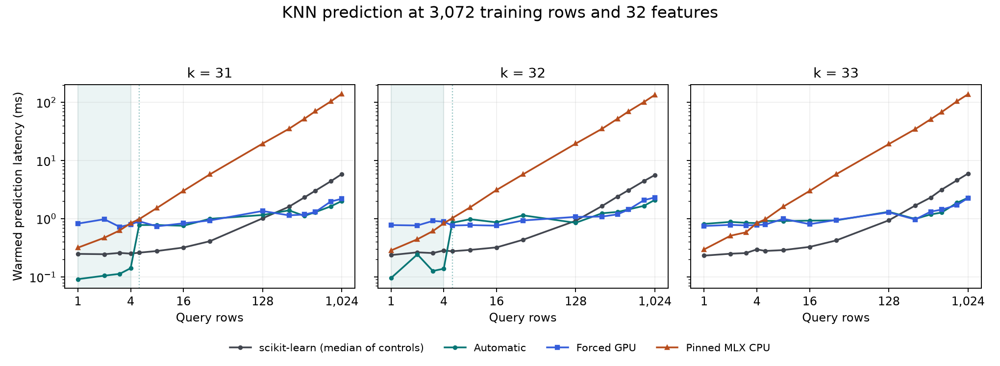

# Warmed KNN prediction across the k=32 gate on M5 Pro

With 3,072 training rows and 32 features, **automatic mode stayed on CPU through four queries at k=31 and k=32, and used GPU from one query at k=33**. Metal traces independently verified these routing decisions. The one-row auto median rose from 0.096 ms at k=32 to 0.817 ms at k=33. At k=33 the paired scikit-learn control took 0.238 ms and pinned MLX CPU took 0.297 ms.

| Neighbors | First auto GPU batch | First forced-GPU two-pass win vs pinned MLX CPU | First auto-GPU two-pass win vs pinned MLX CPU | First batch where both GPU modes beat scikit-learn in both passes |
|---:|---:|---:|---:|---:|
| 31 | 5 | 5 | 5 | 256 |
| 32 | 5 | 5 | 5 | 256 |
| 33 | 1 | 4 | 8 | 256 |

A two-pass win requires a lower median than the paired CPU baseline in both passes. At k=31, the forced result split at four queries. At k=32, forced GPU was slower than pinned CPU in both passes at four. At k=33, forced GPU won both passes at four, while auto needed eight to win both. For all three k values, both GPU modes won in both passes at 256 queries and every larger tested size against scikit-learn. Batches between tested sizes and repeat sessions could shift the observed latency bounds.

The pinned small-query CPU rule requires k ≤ 32, at most 32 features, at most four query rows, and at most 16,384 training/query row pairs for this training size. The alternative wider-feature CPU path does not apply at 32 features. That explains the routing switch at k=33. The GPU search also has a separate k ≤ 16 limit for its fused search eligibility, so these three configurations sit outside that fused-search range. [Pinned routing source](https://github.com/tabulai/mlx-learn/blob/v0.1.2/src/mlxlearn/_kernels/distance.py#L151-L175) · [Device search source](https://github.com/tabulai/mlx-learn/blob/v0.1.2/src/mlxlearn_device/_neighbors.py)

## Workload and timing design

Every case reuses the same 3,072 training rows and the same 32 standardized columns as the [32-feature reference](../knn-feature-sweep/README.md). The case generator uses the same seed-42 16,384-row source and selects the same 32 of the original 33 columns. Query batches are the identical prefixes of the held-out split, and each input fingerprint matches the corresponding k=5 case. Only k changes within each query size. All modes use Euclidean distance and uniform voting. Parity is checked against scikit-learn at the same k.

The 14 query sizes span 1–1,024 rows. Uninstrumented blocks run auto → forced GPU → pinned MLX CPU → pinned MLX CPU → forced GPU → auto. Each block requests four CPU threads and includes a fresh scikit-learn control. Per case and implementation, one fit is followed by a first prediction, one extra warmup, and 15 steady predictions on the same fitted model. Only the steady calls feed latency medians. All 3,780 steady timing pairs passed numerical checks.

The prediction tables report milliseconds as the median of two block medians. The three scikit-learn values are paired controls for auto, forced GPU and pinned CPU. The wins columns count the blocks in which the candidate GPU median beat the named CPU baseline in the same pass. Auto's host results are marked CPU. The fixed MLX CPU path and auto's low-latency host path are distinct implementations.



Shading marks batches routed to CPU in auto mode. The chart uses the median of the three scikit-learn controls. The tables retain the separate paired controls.

## Prediction timings

### k = 31

| Query rows | scikit-learn, auto / forced / CPU blocks | Auto | Forced GPU | MLX CPU | GPU wins vs MLX CPU, auto / forced | GPU wins vs scikit-learn, auto / forced |
|---:|---:|---:|---:|---:|---:|---:|
| 1 | 0.234 / 0.257 / 0.249 | 0.092 | 0.826 | 0.319 | CPU / 0/2 | CPU / 0/2 |
| 2 | 0.240 / 0.246 / 0.268 | 0.105 | 0.983 | 0.472 | CPU / 0/2 | CPU / 0/2 |
| 3 | 0.241 / 0.274 / 0.259 | 0.113 | 0.727 | 0.631 | CPU / 0/2 | CPU / 0/2 |
| 4 | 0.242 / 0.270 / 0.252 | 0.141 | 0.799 | 0.841 | CPU / 1/2 | CPU / 0/2 |
| 5 | 0.262 / 0.261 / 0.272 | 0.781 | 0.907 | 0.985 | 2/2 / 2/2 | 0/2 / 0/2 |
| 8 | 0.268 / 0.279 / 0.285 | 0.782 | 0.742 | 1.540 | 2/2 / 2/2 | 0/2 / 0/2 |
| 16 | 0.321 / 0.328 / 0.320 | 0.759 | 0.837 | 3.022 | 2/2 / 2/2 | 0/2 / 0/2 |
| 32 | 0.379 / 0.411 / 0.428 | 0.999 | 0.936 | 5.797 | 2/2 / 2/2 | 0/2 / 0/2 |
| 128 | 0.908 / 1.042 / 1.018 | 1.161 | 1.362 | 19.601 | 2/2 / 2/2 | 1/2 / 0/2 |
| 256 | 1.549 / 1.614 / 1.681 | 1.396 | 1.146 | 35.268 | 2/2 / 2/2 | 2/2 / 2/2 |
| 384 | 2.250 / 2.334 / 2.337 | 1.122 | 1.185 | 52.436 | 2/2 / 2/2 | 2/2 / 2/2 |
| 512 | 2.840 / 3.041 / 3.090 | 1.303 | 1.308 | 70.646 | 2/2 / 2/2 | 2/2 / 2/2 |
| 768 | 4.259 / 4.421 / 4.433 | 1.637 | 1.986 | 104.137 | 2/2 / 2/2 | 2/2 / 2/2 |
| 1024 | 5.490 / 5.898 / 5.872 | 2.020 | 2.203 | 141.095 | 2/2 / 2/2 | 2/2 / 2/2 |

### k = 32

| Query rows | scikit-learn, auto / forced / CPU blocks | Auto | Forced GPU | MLX CPU | GPU wins vs MLX CPU, auto / forced | GPU wins vs scikit-learn, auto / forced |
|---:|---:|---:|---:|---:|---:|---:|
| 1 | 0.237 / 0.243 / 0.238 | 0.096 | 0.780 | 0.285 | CPU / 0/2 | CPU / 0/2 |
| 2 | 0.308 / 0.255 / 0.265 | 0.244 | 0.768 | 0.445 | CPU / 0/2 | CPU / 0/2 |
| 3 | 0.259 / 0.257 / 0.250 | 0.127 | 0.920 | 0.614 | CPU / 0/2 | CPU / 0/2 |
| 4 | 0.263 / 0.285 / 0.286 | 0.139 | 0.892 | 0.836 | CPU / 1/2 | CPU / 0/2 |
| 5 | 0.253 / 0.357 / 0.277 | 0.854 | 0.765 | 1.027 | 2/2 / 2/2 | 0/2 / 0/2 |
| 8 | 0.318 / 0.292 / 0.281 | 0.983 | 0.780 | 1.574 | 2/2 / 2/2 | 0/2 / 0/2 |
| 16 | 0.317 / 0.323 / 0.322 | 0.868 | 0.762 | 3.129 | 2/2 / 2/2 | 0/2 / 0/2 |
| 32 | 0.491 / 0.436 / 0.406 | 1.147 | 0.936 | 5.799 | 2/2 / 2/2 | 0/2 / 0/2 |
| 128 | 0.894 / 0.925 / 0.930 | 0.854 | 1.079 | 19.627 | 2/2 / 2/2 | 1/2 / 0/2 |
| 256 | 1.716 / 1.659 / 1.652 | 1.246 | 1.092 | 35.342 | 2/2 / 2/2 | 2/2 / 2/2 |
| 384 | 2.293 / 2.442 / 2.415 | 1.311 | 1.193 | 52.456 | 2/2 / 2/2 | 2/2 / 2/2 |
| 512 | 2.945 / 3.241 / 3.107 | 1.447 | 1.438 | 70.089 | 2/2 / 2/2 | 2/2 / 2/2 |
| 768 | 4.275 / 4.541 / 4.456 | 1.670 | 2.091 | 101.634 | 2/2 / 2/2 | 2/2 / 2/2 |
| 1024 | 5.660 / 6.226 / 5.542 | 2.113 | 2.327 | 135.370 | 2/2 / 2/2 | 2/2 / 2/2 |

### k = 33

| Query rows | scikit-learn, auto / forced / CPU blocks | Auto | Forced GPU | MLX CPU | GPU wins vs MLX CPU, auto / forced | GPU wins vs scikit-learn, auto / forced |
|---:|---:|---:|---:|---:|---:|---:|
| 1 | 0.238 / 0.233 / 0.225 | 0.817 | 0.752 | 0.297 | 0/2 / 0/2 | 0/2 / 0/2 |
| 2 | 0.243 / 0.251 / 0.319 | 0.885 | 0.786 | 0.512 | 0/2 / 0/2 | 0/2 / 0/2 |
| 3 | 0.258 / 0.299 / 0.257 | 0.853 | 0.769 | 0.586 | 0/2 / 0/2 | 0/2 / 0/2 |
| 4 | 0.330 / 0.298 / 0.255 | 0.845 | 0.779 | 0.846 | 1/2 / 2/2 | 0/2 / 0/2 |
| 5 | 0.267 / 0.293 / 0.280 | 0.920 | 0.796 | 0.979 | 1/2 / 2/2 | 0/2 / 0/2 |
| 8 | 0.275 / 0.290 / 0.307 | 0.917 | 0.998 | 1.617 | 2/2 / 2/2 | 0/2 / 0/2 |
| 16 | 0.306 / 0.348 / 0.329 | 0.930 | 0.809 | 3.016 | 2/2 / 2/2 | 0/2 / 0/2 |
| 32 | 0.394 / 0.426 / 0.424 | 0.940 | 0.954 | 5.818 | 2/2 / 2/2 | 0/2 / 0/2 |
| 128 | 0.913 / 0.964 / 0.942 | 1.320 | 1.292 | 19.239 | 2/2 / 2/2 | 0/2 / 0/2 |
| 256 | 1.597 / 1.689 / 1.704 | 0.995 | 0.973 | 34.826 | 2/2 / 2/2 | 2/2 / 2/2 |
| 384 | 2.322 / 2.646 / 2.290 | 1.188 | 1.328 | 51.413 | 2/2 / 2/2 | 2/2 / 2/2 |
| 512 | 3.174 / 3.112 / 3.183 | 1.280 | 1.437 | 68.256 | 2/2 / 2/2 | 2/2 / 2/2 |
| 768 | 4.599 / 4.674 / 4.490 | 1.886 | 1.726 | 104.958 | 2/2 / 2/2 | 2/2 / 2/2 |
| 1024 | 6.004 / 5.983 / 5.948 | 2.298 | 2.272 | 138.411 | 2/2 / 2/2 | 2/2 / 2/2 |

## Independent Metal evidence

Separate command-completion replays cover all 42 query/neighbor shapes in auto, forced GPU and pinned CPU modes. Each prediction trace follows two predictions on the same fitted model. All forced predictions submitted GPU work. Auto submitted zero Metal buffers through four queries at k=31 and k=32, then submitted GPU work from five queries onward. At k=33 auto submitted GPU work for all query counts. All pinned CPU predictions, scikit-learn controls and fit windows submitted zero Metal buffers. All 126 traced comparisons passed numerical checks. The traces retain Metal GPU timestamps scoped to the operation, routing events and input fingerprints. [Apple Metal GPU timestamps](https://developer.apple.com/documentation/metal/mtlcommandbuffer/gpustarttime)

- [k=31, four queries](metal/auto-k31-q4/metadata.json) and [five queries](metal/auto-k31-q5/metadata.json)
- [k=32, four queries](metal/auto-k32-q4/metadata.json) and [five queries](metal/auto-k32-q5/metadata.json)
- [k=33, one query](metal/auto-k33-q1/metadata.json)
- [All trace directories](metal/)

## Raw data and reproduction

[Comparison JSON](comparison.json) has block medians and dispersion, ratios against scikit-learn, and per-pass ratios against pinned MLX CPU. Each [timing run](runs/) contains its manifest, raw measurement rows and run summaries.

Use the locked Apple Silicon environment and fresh output directories. Run timing, then tracing.

```sh
config=scripts/knn-neighbor-sweep.yaml
.venv/bin/python scripts/benchmark_routing.py results/knn-neighbor-timing-replay \
  --config "$config" --with-mlx-cpu
.venv/bin/python scripts/summarize_routing.py results/knn-neighbor-timing-replay/*

out=results/knn-neighbor-metal-replay
mkdir -p "$out"
xcrun clang -dynamiclib -fobjc-arc -framework Foundation -framework Metal \
  scripts/metal_command_trace.m -o "$out/probe.dylib"
for mode in cpu auto forced; do
  if [ "$mode" = forced ]; then export MLXLEARN_FORCE_BACKEND=mlx; else unset MLXLEARN_FORCE_BACKEND; fi
  for k in 31 32 33; do
    for q in 1 2 3 4 5 8 16 32 128 256 384 512 768 1024; do
      tag="$mode-k$k-q$q"
      MTL_CAPTURE_ENABLED=1 VECLIB_MAXIMUM_THREADS=4 OMP_NUM_THREADS=4 \
        .venv/bin/python scripts/trace_fit_inference.py "knn-16384x32-c2-k$k-t3072-s33-q$q" \
        "$out/$tag" "$out/probe.dylib" --mode "$mode" --reuse-model \
        --config "$config" --completion-only > "$out/$tag.json"
    done
  done
done
unset MLXLEARN_FORCE_BACKEND
```
