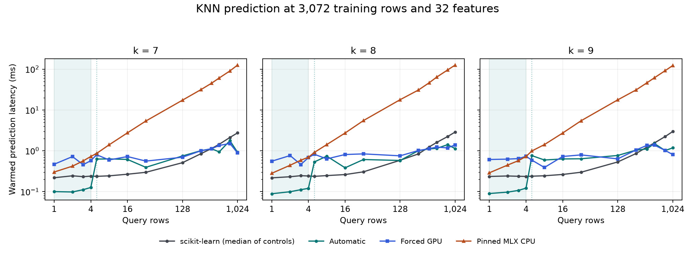

# Warmed KNN across the small-query GPU cutoff on M5 Pro

With 3,072 training rows and 32 features, forced GPU used the specialized small-query search for k=7 and k=8 at one through four queries. At k=9 it used fused screen search even for one query. At five queries and above, all three k values used fused screen search on the GPU. Auto used the CPU for one through four queries, so it bypassed the specialized kernel under these conditions. [Device search rules](https://github.com/tabulai/mlx-learn/blob/v0.1.2/src/mlxlearn_device/_neighbors.py) · [Automatic routing rule](https://github.com/tabulai/mlx-learn/blob/v0.1.2/src/mlxlearn/_kernels/distance.py#L151-L175)

| Neighbors | Forced GPU search at 1–4 queries | First forced GPU win vs pinned MLX CPU | First auto GPU win vs pinned MLX CPU | First batch where both GPU modes beat scikit-learn |
|---:|---|---:|---:|---:|
| 7 | Small-query | 5 | 5 | 512 |
| 8 | Small-query | 4 | 5 | 512 |
| 9 | Fused screen | 5 | 5 | 768 |

A win requires the median to beat its corresponding baseline in both passes. At each k, both GPU modes kept their joint lead over scikit-learn at every larger tested size. At k=9 and 512 queries, forced GPU beat scikit-learn in both passes and auto won one pass.

At four queries, forced GPU took 0.574, 0.682, and 0.733 ms for k=7, 8, and 9, respectively. Auto took 0.126, 0.120, and 0.122 ms on the host, the lowest median of the four modes at each k. At five queries, auto switched to fused GPU search and took 0.628, 0.533, and 0.761 ms, ahead of pinned MLX CPU in both passes at every k. The separate timing runs measure full prediction latency across these shapes.

## Timing design

The sweep uses the same seed-42 split, 3,072 training rows, 32 standardized features, and query prefixes as the [32-feature k=5 reference](../knn-feature-sweep/README.md). Input fingerprints match the reference at each query size. All modes use Euclidean distance and uniform voting, with predictions checked against scikit-learn at the same k.

The 14 query sizes span 1–1,024 rows. Uninstrumented blocks run auto → forced GPU → pinned MLX CPU → pinned MLX CPU → forced GPU → auto. Each block requests four CPU threads and runs a fresh scikit-learn control. Per shape and implementation, one fit is followed by a first prediction, another warmup, and 15 timed predictions on the same fitted model. All 3,780 steady timing pairs passed numerical checks.

The tables report milliseconds as the median of two block medians. The three scikit-learn values correspond to controls for auto, forced GPU, and pinned MLX CPU. The wins columns count passes where the GPU median beat the named baseline. Auto’s low-latency host path and explicitly pinned MLX CPU use distinct prediction implementations.



Shading marks automatic CPU routing. The plot uses the median of the three scikit-learn controls.

## Prediction timings

### k = 7

| Query rows | scikit-learn, auto / forced / CPU blocks | Auto | Forced GPU | MLX CPU | GPU wins vs MLX CPU, auto / forced | GPU wins vs scikit-learn, auto / forced |
|---:|---:|---:|---:|---:|---:|---:|
| 1 | 0.218 / 0.219 / 0.220 | 0.100 | 0.468 | 0.302 | CPU / 0/2 | CPU / 0/2 |
| 2 | 0.246 / 0.236 / 0.244 | 0.098 | 0.722 | 0.421 | CPU / 0/2 | CPU / 0/2 |
| 3 | 0.231 / 0.233 / 0.244 | 0.112 | 0.457 | 0.567 | CPU / 1/2 | CPU / 0/2 |
| 4 | 0.240 / 0.239 / 0.240 | 0.126 | 0.574 | 0.727 | CPU / 1/2 | CPU / 0/2 |
| 5 | 0.237 / 0.235 / 0.258 | 0.628 | 0.800 | 0.866 | 2/2 / 2/2 | 0/2 / 0/2 |
| 8 | 0.251 / 0.244 / 0.242 | 0.633 | 0.597 | 1.404 | 2/2 / 2/2 | 0/2 / 0/2 |
| 16 | 0.267 / 0.292 / 0.261 | 0.615 | 0.724 | 2.762 | 2/2 / 2/2 | 0/2 / 0/2 |
| 32 | 0.293 / 0.297 / 0.304 | 0.394 | 0.560 | 5.369 | 2/2 / 2/2 | 0/2 / 0/2 |
| 128 | 0.512 / 0.503 / 0.551 | 0.748 | 0.697 | 17.455 | 2/2 / 2/2 | 0/2 / 0/2 |
| 256 | 0.847 / 0.831 / 0.936 | 1.008 | 1.001 | 31.501 | 2/2 / 2/2 | 0/2 / 0/2 |
| 384 | 1.197 / 1.131 / 1.139 | 1.125 | 1.123 | 45.389 | 2/2 / 2/2 | 1/2 / 1/2 |
| 512 | 1.445 / 1.454 / 1.439 | 0.941 | 1.353 | 60.895 | 2/2 / 2/2 | 2/2 / 2/2 |
| 768 | 2.123 / 2.090 / 2.178 | 1.772 | 1.512 | 90.748 | 2/2 / 2/2 | 2/2 / 2/2 |
| 1024 | 2.751 / 2.751 / 2.755 | 0.924 | 0.888 | 126.172 | 2/2 / 2/2 | 2/2 / 2/2 |

### k = 8

| Query rows | scikit-learn, auto / forced / CPU blocks | Auto | Forced GPU | MLX CPU | GPU wins vs MLX CPU, auto / forced | GPU wins vs scikit-learn, auto / forced |
|---:|---:|---:|---:|---:|---:|---:|
| 1 | 0.218 / 0.217 / 0.217 | 0.089 | 0.556 | 0.281 | CPU / 0/2 | CPU / 0/2 |
| 2 | 0.232 / 0.239 / 0.231 | 0.099 | 0.766 | 0.443 | CPU / 0/2 | CPU / 0/2 |
| 3 | 0.246 / 0.230 / 0.250 | 0.112 | 0.461 | 0.589 | CPU / 1/2 | CPU / 0/2 |
| 4 | 0.235 / 0.242 / 0.243 | 0.120 | 0.682 | 0.695 | CPU / 2/2 | CPU / 0/2 |
| 5 | 0.246 / 0.234 / 0.237 | 0.533 | 0.823 | 0.912 | 2/2 / 2/2 | 0/2 / 0/2 |
| 8 | 0.239 / 0.247 / 0.269 | 0.740 | 0.634 | 1.421 | 2/2 / 2/2 | 0/2 / 0/2 |
| 16 | 0.262 / 0.265 / 0.255 | 0.384 | 0.812 | 2.732 | 2/2 / 2/2 | 0/2 / 0/2 |
| 32 | 0.305 / 0.305 / 0.315 | 0.612 | 0.841 | 5.508 | 2/2 / 2/2 | 0/2 / 0/2 |
| 128 | 0.516 / 0.586 / 1.055 | 0.580 | 0.754 | 17.906 | 2/2 / 2/2 | 0/2 / 1/2 |
| 256 | 0.966 / 0.827 / 0.841 | 1.010 | 1.016 | 30.946 | 2/2 / 2/2 | 0/2 / 0/2 |
| 384 | 1.259 / 1.164 / 1.249 | 1.115 | 1.129 | 46.581 | 2/2 / 2/2 | 2/2 / 1/2 |
| 512 | 1.610 / 1.627 / 1.583 | 1.150 | 1.235 | 64.327 | 2/2 / 2/2 | 2/2 / 2/2 |
| 768 | 2.233 / 2.154 / 2.303 | 1.412 | 1.178 | 95.577 | 2/2 / 2/2 | 2/2 / 2/2 |
| 1024 | 2.882 / 2.862 / 2.991 | 1.134 | 1.398 | 126.317 | 2/2 / 2/2 | 2/2 / 2/2 |

### k = 9

| Query rows | scikit-learn, auto / forced / CPU blocks | Auto | Forced GPU | MLX CPU | GPU wins vs MLX CPU, auto / forced | GPU wins vs scikit-learn, auto / forced |
|---:|---:|---:|---:|---:|---:|---:|
| 1 | 0.229 / 0.235 / 0.236 | 0.090 | 0.613 | 0.289 | CPU / 0/2 | CPU / 0/2 |
| 2 | 0.248 / 0.231 / 0.242 | 0.097 | 0.626 | 0.448 | CPU / 1/2 | CPU / 0/2 |
| 3 | 0.238 / 0.233 / 0.238 | 0.107 | 0.645 | 0.575 | CPU / 1/2 | CPU / 0/2 |
| 4 | 0.238 / 0.234 / 0.236 | 0.122 | 0.733 | 0.729 | CPU / 0/2 | CPU / 0/2 |
| 5 | 0.237 / 0.312 / 0.239 | 0.761 | 0.591 | 0.995 | 2/2 / 2/2 | 0/2 / 0/2 |
| 8 | 0.245 / 0.242 / 0.250 | 0.596 | 0.390 | 1.419 | 2/2 / 2/2 | 0/2 / 0/2 |
| 16 | 0.259 / 0.278 / 0.264 | 0.632 | 0.727 | 2.733 | 2/2 / 2/2 | 0/2 / 0/2 |
| 32 | 0.299 / 0.303 / 0.295 | 0.639 | 0.794 | 5.451 | 2/2 / 2/2 | 0/2 / 0/2 |
| 128 | 0.524 / 0.534 / 0.641 | 0.769 | 0.635 | 17.738 | 2/2 / 2/2 | 0/2 / 0/2 |
| 256 | 0.859 / 0.896 / 0.859 | 1.041 | 1.050 | 31.071 | 2/2 / 2/2 | 0/2 / 0/2 |
| 384 | 1.202 / 1.773 / 1.231 | 1.110 | 1.356 | 46.223 | 2/2 / 2/2 | 2/2 / 1/2 |
| 512 | 1.560 / 1.545 / 1.569 | 1.505 | 1.378 | 61.710 | 2/2 / 2/2 | 1/2 / 2/2 |
| 768 | 2.231 / 2.237 / 2.261 | 1.016 | 1.023 | 91.977 | 2/2 / 2/2 | 2/2 / 2/2 |
| 1024 | 2.974 / 2.914 / 3.006 | 1.181 | 0.808 | 123.269 | 2/2 / 2/2 | 2/2 / 2/2 |

## Metal dispatch verification

Separate trace replays cover all 42 shapes in each of the three mlx-learn modes and include a scikit-learn control. The observer captures the active Metal pipeline and thread grid at each dispatch during a single prediction after two warmup calls on the same fitted model. A separate completion log records completed command buffers and GPU timestamps. The evidence identifies the search kernel and records GPU execution at the command-buffer level.

The small-query search dispatches `mlxlearn_small_neighbors`, with voting dispatched separately. The fused search dispatches `mlxlearn_screen_scan` and subsequent screen kernels. Auto CPU, pinned MLX CPU, and scikit-learn predictions submitted zero Metal buffers and recorded zero dispatches. Fit submitted zero buffers in every replay. All 126 traced comparisons passed numerical parity. [Small-query implementation](https://github.com/tabulai/mlx-learn/blob/v0.1.2/src/mlxlearn_device/_neighbors_small.py) · [Fused screen implementation](https://github.com/tabulai/mlx-learn/blob/v0.1.2/src/mlxlearn_device/_neighbors_screen.py)

- Forced GPU at four queries · [k=7](metal/forced-k7-q4/mlxlearn-predict-dispatch.tsv), [k=8](metal/forced-k8-q4/mlxlearn-predict-dispatch.tsv), [k=9](metal/forced-k9-q4/mlxlearn-predict-dispatch.tsv)
- Forced GPU at k=8 · [four queries](metal/forced-k8-q4/mlxlearn-predict-dispatch.tsv), [five queries](metal/forced-k8-q5/mlxlearn-predict-dispatch.tsv)
- Auto at k=8 · [four queries](metal/auto-k8-q4/metadata.json), [five queries](metal/auto-k8-q5/metadata.json)

## Raw data and reproduction

The [timing runs](runs/) contain manifests, raw measurements, and summaries. The [comparison JSON](comparison.json) contains block-level medians, dispersion, and speed ratios. The [trace directory](metal/) contains dispatch and completion logs with metadata linking each shape to its timing runs.

Use the locked Apple Silicon environment and fresh output directories. Run timing before tracing.

```sh
config=scripts/knn-small-k-sweep.yaml
.venv/bin/python scripts/benchmark_routing.py results/knn-small-k-timing-replay \
  --config "$config" --with-mlx-cpu
.venv/bin/python scripts/summarize_routing.py results/knn-small-k-timing-replay/*

out=results/knn-small-k-metal-replay
mkdir -p "$out"
xcrun clang -dynamiclib -fobjc-arc -framework Foundation -framework Metal \
  scripts/metal_command_trace.m -o "$out/probe.dylib"
for mode in cpu auto forced; do
  if [ "$mode" = forced ]; then export MLXLEARN_FORCE_BACKEND=mlx; else unset MLXLEARN_FORCE_BACKEND; fi
  for k in 7 8 9; do
    for q in 1 2 3 4 5 8 16 32 128 256 384 512 768 1024; do
      tag="$mode-k$k-q$q"
      MTL_CAPTURE_ENABLED=1 VECLIB_MAXIMUM_THREADS=4 OMP_NUM_THREADS=4 \
        .venv/bin/python scripts/trace_fit_inference.py "knn-16384x32-c2-k$k-t3072-s33-q$q" \
        "$out/$tag" "$out/probe.dylib" --mode "$mode" --reuse-model \
        --config "$config" --completion-only --dispatches > "$out/$tag.json"
    done
  done
done
unset MLXLEARN_FORCE_BACKEND
```
