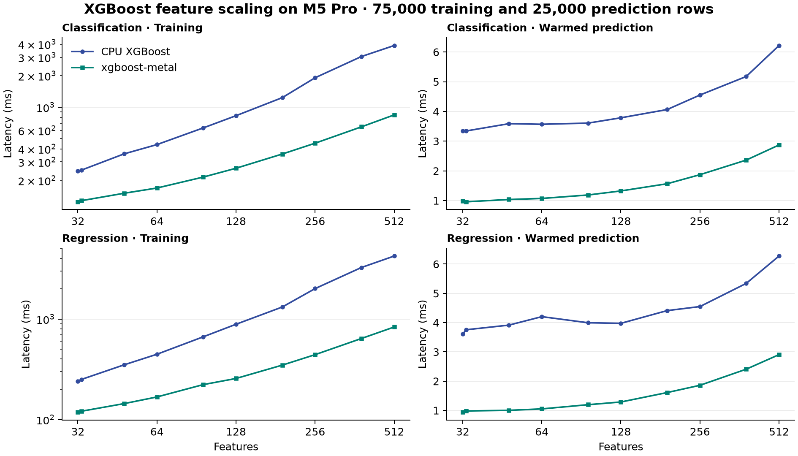

# XGBoost feature scaling on M5 Pro

With 75,000 training rows and 25,000 prediction rows, xgboost-metal beat four-thread CPU XGBoost in both timing passes for training and warmed prediction at every tested width from 32 to 512 features.

From 32 to 512 features, Metal's training advantage rose from 1.97× to 4.60× for classification and from 2.03× to 5.08× for regression. Its warmed prediction advantage narrowed from 3.37× to 2.17× for classification and from 3.86× to 2.16× for regression. Metal remained faster for both operations throughout the sweep.



## Timings

Values are the median of the two pass medians. Ratios divide the displayed CPU latency by the Metal latency using unrounded values.

| Workload | Features | Training CPU / Metal (ms) | CPU ÷ Metal | Warmed prediction CPU / Metal (ms) | CPU ÷ Metal |
|---|---:|---:|---:|---:|---:|
| Classification | 32 | 245.557 / 124.809 | 1.97× | 3.347 / 0.992 | 3.37× |
| Classification | 33 | 250.415 / 127.881 | 1.96× | 3.344 / 0.961 | 3.48× |
| Classification | 48 | 358.226 / 150.592 | 2.38× | 3.588 / 1.038 | 3.46× |
| Classification | 64 | 439.290 / 168.931 | 2.60× | 3.568 / 1.073 | 3.33× |
| Classification | 96 | 633.868 / 214.895 | 2.95× | 3.607 / 1.189 | 3.03× |
| Classification | 128 | 829.434 / 261.002 | 3.18× | 3.786 / 1.326 | 2.86× |
| Classification | 192 | 1234.082 / 356.936 | 3.46× | 4.063 / 1.567 | 2.59× |
| Classification | 256 | 1910.810 / 452.824 | 4.22× | 4.551 / 1.872 | 2.43× |
| Classification | 384 | 3046.634 / 648.650 | 4.70× | 5.175 / 2.363 | 2.19× |
| Classification | 512 | 3883.276 / 844.017 | 4.60× | 6.217 / 2.871 | 2.17× |
| Regression | 32 | 239.700 / 118.149 | 2.03× | 3.613 / 0.936 | 3.86× |
| Regression | 33 | 250.730 / 121.059 | 2.07× | 3.756 / 0.982 | 3.82× |
| Regression | 48 | 350.465 / 144.180 | 2.43× | 3.915 / 1.003 | 3.90× |
| Regression | 64 | 446.482 / 167.886 | 2.66× | 4.204 / 1.052 | 4.00× |
| Regression | 96 | 665.483 / 222.728 | 2.99× | 3.995 / 1.196 | 3.34× |
| Regression | 128 | 887.468 / 256.373 | 3.46× | 3.976 / 1.288 | 3.09× |
| Regression | 192 | 1317.480 / 348.009 | 3.79× | 4.410 / 1.610 | 2.74× |
| Regression | 256 | 2008.507 / 442.369 | 4.54× | 4.548 / 1.858 | 2.45× |
| Regression | 384 | 3253.448 / 640.132 | 5.08× | 5.339 / 2.409 | 2.22× |
| Regression | 512 | 4232.505 / 833.212 | 5.08× | 6.274 / 2.906 | 2.16× |

Training measures `xgb.train` after training matrix ingestion. Warmed prediction measures `Booster.inplace_predict` from a NumPy array through materialized output. [Per-pass ratios and stage breakdown](comparison.json) · [Raw timings](timing/measurements.json) · [Medians, ranges, and MAD](timing/summary.json)

## Workload design and quality

The sweep keeps the original [baseline](../xgboost-baseline/README.md) row split, labels, and 32 float32 columns. It appends independent standard-normal columns with train and test RNG seeds 43 and 44. Wider cases keep all columns from narrower cases byte-for-byte. The two engines receive identical input fingerprints at each width. The 32-feature fingerprints match the baseline. This measures the cost of adding columns without adding predictive signal.

The worker environments use XGBoost 3.4.1 and xgboost-metal 0.1.1. The CPU worker requested four OpenMP threads. Both engines use the baseline's 100 histogram boosting rounds, depth six, 256 bins, and seed 42. At each width, CPU runs first in one pass and Metal runs first in the other. Each pass includes three steady fits and ten warmed predictions per engine. Models are fit independently at each width.

All 120 timed model pairs passed the baseline held-out quality gates. The gates compare CPU and Metal at the same width. Changing the number of noise features can change the fitted tree structures and prediction latency. [Timing manifest](timing/manifest.json) · [Per-fit quality checks](timing/correctness.json)

## Metal verification

Separate replays scoped training and one warmed prediction at all ten widths for both workloads. Every Metal training replay completed 206 command buffers, with 1,520 observed direct dispatches for classification and 1,720 for regression. The training logs include gradient, quantization, and tree-building kernels. Every warmed Metal prediction completed two buffers and dispatched input staging and `predict_tree_cached`. Classification also dispatched the probability transform. The observed pipeline names and dispatch counts stayed the same at every tested width for each task.

All counted Metal buffers completed with positive GPU timestamps on the M5 Pro. CPU controls recorded zero Metal submissions and zero compute dispatches in both operations. All 20 trace pairs passed the held-out quality checks. [Trace manifest](metal/manifest.json) · [Trace quality checks](metal/correctness.json)

- Classification · [32-feature training](metal/classification/features-32/pass-1-metal/train-dispatch.tsv) · [512-feature training](metal/classification/features-512/pass-1-metal/train-dispatch.tsv) · [512-feature prediction](metal/classification/features-512/pass-1-metal/predict-dispatch.tsv)
- Regression · [32-feature training](metal/regression/features-32/pass-1-metal/train-dispatch.tsv) · [512-feature training](metal/regression/features-512/pass-1-metal/train-dispatch.tsv) · [512-feature prediction](metal/regression/features-512/pass-1-metal/predict-dispatch.tsv)
- [All dispatch and completion logs](metal/)

## Reproduce

Set up the pinned worker environments and compile the observer using the [baseline instructions](../xgboost-baseline/README.md#reproduce). Run the timing sweep before the trace replay.

```sh
envs=results/xgboost-envs
sweep() {
  uv run --locked python -m mlx_m5_bench.xgboost_bench \
    --cpu-python "$envs/cpu/bin/python" --metal-python "$envs/metal/bin/python" "$@" \
    --features 32 33 48 64 96 128 192 256 384 512
}
sweep --output results/xgb-feature-timing
sweep --output results/xgb-feature-trace --probe "$envs/probe.dylib"
```
