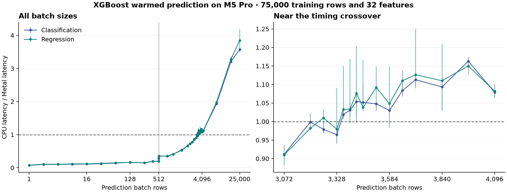

# XGBoost warmed prediction by batch size on M5 Pro

With 75,000 training rows and 32 features, **3,360 queries** was the first tested batch where xgboost-metal beat CPU XGBoost in every measured pass for both workloads. Some larger batches still split the passes. Metal won every measured pass at **3,648 queries and above for classification** and **3,424 and above for regression**. These are bounds on the tested grid.

Metal switched GPU prediction kernels at 512 queries. That reduced its latency, while the four-thread CPU baseline remained faster at that batch.



Each point is the median of the pass ratios. Bars show the minimum and maximum ratios. The dashed line marks equal latency. The vertical line marks the observed Metal kernel switch at 512 queries.

## Warmed prediction timings

Times are microseconds, shown as CPU / Metal. The reported value is the median of the block medians. Wins count paired passes where Metal had the lower median.

| Query rows | Classification (µs) | Metal wins | Regression (µs) | Metal wins |
|---:|---:|---:|---:|---:|
| 1 | 59.04 / 804.12 | 0/2 | 59.12 / 748.20 | 0/2 |
| 511 | 146.04 / 736.90 | 0/2 | 139.40 / 724.39 | 0/2 |
| 512 | 145.48 / 506.66 | 0/2 | 141.37 / 509.94 | 0/2 |
| 3,328 | 509.04 / 526.03 | 1/6 | 502.13 / 516.53 | 1/6 |
| 3,360 | 528.16 / 517.47 | 4/4 | 523.21 / 511.29 | 4/4 |
| 3,392 | 530.24 / 513.92 | 4/4 | 520.18 / 508.68 | 3/4 |
| 3,424 | 542.86 / 515.47 | 3/4 | 534.56 / 502.63 | 4/4 |
| 3,584 | 540.80 / 525.53 | 5/6 | 540.07 / 514.60 | 6/6 |
| 3,648 | 563.04 / 519.34 | 4/4 | 555.60 / 509.20 | 4/4 |
| 4,096 | 609.50 / 568.23 | 4/4 | 596.75 / 552.93 | 4/4 |
| 25,000 | 3,381.17 / 946.34 | 2/2 | 3,693.06 / 958.45 | 2/2 |

The first all-pass wins at 3,360 were about 2% in median latency for both workloads. At 25,000 queries, Metal was 3.57× faster for classification and 3.85× for regression based on the displayed medians. [All 39 batch sizes and per-pass ratios](comparison.json)

## Measurement method

Both tasks reuse the [XGBoost baseline](../xgboost-baseline/README.md) splits and parameters, including a seed of 42, 100 histogram boosting rounds, depth six, and 256 bins. Each query batch is a prefix of the same 25,000 held-out rows. The dataset fingerprints match the baseline. The engines are XGBoost 3.4.1 with four CPU threads and xgboost-metal 0.1.1.

Each worker fits one booster and reuses it for every batch size in that block. The worker calls `Booster.inplace_predict` on the NumPy prefix. Two untimed predictions at each size precede 30 timed predictions. The first pass runs CPU then Metal with increasing batch sizes. The second runs Metal then CPU with decreasing batch sizes. All training and warmups are outside the prediction timings.

Across the initial grid, refinement, and two confirmation runs, there were 13,920 timed prediction calls. Each timed or traced output passed a shape check and matched the same model's full held-out output prefix within atol=1e-7 and rtol=1e-6. All 16 pairs of models from timing runs and both pairs from trace runs passed the full held-out quality checks.

- Grid · [measurements](grid/measurements.json) · [statistics](grid/summary.json) · [quality checks](grid/correctness.json) · [manifest](grid/manifest.json)
- Refinement · [measurements](refine/measurements.json) · [statistics](refine/summary.json) · [quality checks](refine/correctness.json) · [manifest](refine/manifest.json)
- Confirmation A · [measurements](confirm-a/measurements.json) · [statistics](confirm-a/summary.json) · [quality checks](confirm-a/correctness.json) · [manifest](confirm-a/manifest.json)
- Confirmation B · [measurements](confirm-b/measurements.json) · [statistics](confirm-b/summary.json) · [quality checks](confirm-b/correctness.json) · [manifest](confirm-b/manifest.json)

## Metal verification

Separate replays traced 15 prediction sizes per task. Every Metal prediction completed two command buffers with positive GPU timestamps, and every corresponding CPU control recorded zero Metal submissions and zero compute dispatches. Below 512 rows, Metal dispatched `predict`. At 512 rows and above, Metal dispatched `predict_tree_cached`, which caches tree nodes during traversal. Both paths also dispatched input staging. Classification dispatched a probability transform. Across the measured timing crossover, Metal continued to use the same tree-cached kernel. [Pinned kernel selection source](https://github.com/tabulai/xgboost-metal/blob/v0.1.1/src/learner.cpp#L579-L591) · [Trace manifest](metal/manifest.json)

- Classification · [511 rows](metal/classification/pass-1-metal/predict-q511-dispatch.tsv) · [512 rows](metal/classification/pass-1-metal/predict-q512-dispatch.tsv) · [3,360 rows](metal/classification/pass-1-metal/predict-q3360-dispatch.tsv)
- Regression · [511 rows](metal/regression/pass-1-metal/predict-q511-dispatch.tsv) · [512 rows](metal/regression/pass-1-metal/predict-q512-dispatch.tsv) · [3,360 rows](metal/regression/pass-1-metal/predict-q3360-dispatch.tsv)
- [All dispatch and completion logs](metal/) · [Trace quality checks](metal/correctness.json)

## Reproduce

Set up the pinned worker environments and compile the observer using the [baseline instructions](../xgboost-baseline/README.md#reproduce). Run the timing sweeps before the trace replay.

```sh
envs=results/xgboost-envs
sweep() {
  uv run --locked python -m mlx_m5_bench.xgboost_bench \
    --cpu-python "$envs/cpu/bin/python" --metal-python "$envs/metal/bin/python" "$@"
}
sweep --output results/xgb-query-grid \
  --query-rows 1 2 4 8 16 32 64 128 256 384 511 512 513 768 1024 1536 2048 4096 8192 16384 25000
sweep --output results/xgb-query-refine \
  --query-rows 2048 2304 2560 2816 3072 3328 3456 3584 3712 3840 3968 4096 4352
for run in a b; do
  sweep --output "results/xgb-query-confirm-$run" \
    --query-rows 3200 3264 3328 3360 3392 3424 3456 3520 3584 3648 3712 3840
done
sweep --output results/xgb-query-trace --probe "$envs/probe.dylib" \
  --query-rows 1 511 512 513 3200 3264 3328 3360 3392 3424 3456 3584 3648 4096 25000
```
