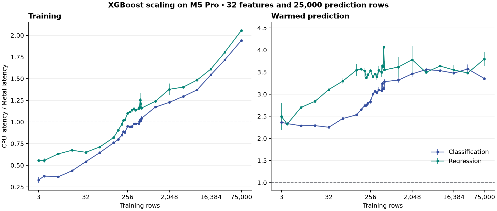

# XGBoost training-set scaling on M5 Pro

With 32 features and the same 25,000-row prediction batch per task, xgboost-metal first won training in both timing passes at **464 training rows for classification** and **208 for regression**. CPU won every pass at the next smaller tested sizes, 448 and 192, respectively. Metal won every measured training pass at larger sizes. The first training wins were narrow. The classification margin at 464 rows was about 0.4 ms, and the regression margin at 208 was about 1.5 ms.

Metal already won warmed prediction at three training rows, the smallest size on the shared grid, and stayed ahead in every pass at every larger size. The three-row classification prefix contains both classes. The two-row prefix is single-class.



Each point is the median ratio across paired timing passes. Error bars show the full range of pass ratios. The dashed line marks equal latency.

## Training and prediction timings

Times are median milliseconds across block medians, shown as CPU / Metal. The winners column counts passes in which Metal's median was lower. Some sizes were repeated in the confirmation grid and have four passes.

| Workload | Training rows | Training (ms) | Metal training wins | Warmed prediction (ms) | Metal prediction wins |
|---|---:|---:|---:|---:|---:|
| Classification | 3 | 9.787 / 29.859 | 0/2 | 1.148 / 0.486 | 2/2 |
| Classification | 448 | 64.168 / 65.466 | 0/4 | 2.946 / 0.953 | 4/4 |
| Classification | 464 | 66.177 / 65.749 | 2/2 | 2.996 / 0.925 | 2/2 |
| Classification | 512 | 68.810 / 66.118 | 4/4 | 3.050 / 0.933 | 4/4 |
| Classification | 75,000 | 240.836 / 124.083 | 2/2 | 3.375 / 1.006 | 2/2 |
| Regression | 3 | 21.515 / 38.683 | 0/2 | 1.679 / 0.673 | 2/2 |
| Regression | 192 | 77.016 / 78.976 | 0/4 | 3.272 / 0.922 | 4/4 |
| Regression | 208 | 80.135 / 78.682 | 2/2 | 3.270 / 0.970 | 2/2 |
| Regression | 224 | 81.372 / 79.541 | 4/4 | 3.246 / 0.947 | 4/4 |
| Regression | 75,000 | 243.028 / 118.174 | 2/2 | 3.482 / 0.918 | 2/2 |

The crossovers refer to the `train` operation with an existing training matrix and the fixed 100-round configuration. The per-run summaries include matrix ingestion, first prediction, and the sum of those stages with training. The warmed prediction measurement uses the same held-out array and returns materialized predictions. [All sizes and per-pass comparisons](comparison.json)

## Workloads and correctness

The sweep keeps the [baseline datasets, solver parameters, and engine versions](../xgboost-baseline/README.md) and takes nested prefixes of the original 75,000-row training split. Per-task test features and labels are byte-identical at all sizes. The 75,000-row dataset fingerprints match the baseline. Both engines use 100 rounds, depth six, and 256 bins. The CPU baseline uses four requested threads. Each size runs CPU → Metal and Metal → CPU with three fresh steady fits and ten warmed predictions per engine and pass. Metal tracing runs separately.

The initial grid covers 32–75,000 rows. The refinement adds smaller prefixes and probes near the training crossings. The confirmation rechecks both bounds and samples intermediate sizes. In total, 28 distinct sizes per task produced 384 paired steady fits across the three runs. Every pair passed the baseline held-out quality gates. The quality checks compare the engines at the same size. Model quality at a given size depends on the available training data.

- Initial grid · [raw timings](grid/measurements.json) · [statistics](grid/summary.json) · [quality](grid/correctness.json) · [manifest](grid/manifest.json)
- Refinement · [raw timings](refine/measurements.json) · [statistics](refine/summary.json) · [quality](refine/correctness.json) · [manifest](refine/manifest.json)
- Confirmation · [raw timings](confirm/measurements.json) · [statistics](confirm/summary.json) · [quality](confirm/correctness.json) · [manifest](confirm/manifest.json)

## Metal verification

The replays cover ten sizes per task, including both sides of each training crossover and the three-row case. Every Metal training operation completed 206 GPU command buffers and dispatched gradient, quantization, and tree-building kernels. Every Metal warmed prediction completed two buffers and dispatched `predict_tree_cached`. Classification also dispatched the probability transform. CPU controls recorded zero Metal submissions and zero compute dispatches. All 20 trace pairs passed the same held-out quality gates. Metal executes GPU work on both sides of the timing crossover.

- Classification training · [448 rows](metal/classification/train-448/pass-1-metal/train-dispatch.tsv) · [464 rows](metal/classification/train-464/pass-1-metal/train-dispatch.tsv)
- Regression training · [192 rows](metal/regression/train-192/pass-1-metal/train-dispatch.tsv) · [208 rows](metal/regression/train-208/pass-1-metal/train-dispatch.tsv)
- Warmed prediction at three training rows · [classification](metal/classification/train-3/pass-1-metal/predict-dispatch.tsv) · [regression](metal/regression/train-3/pass-1-metal/predict-dispatch.tsv)
- [All dispatch and completion logs](metal/) · [Trace manifest](metal/manifest.json) · [Trace quality checks](metal/correctness.json)

## Reproduce

Set up the pinned worker environments and compile the observer using the [baseline instructions](../xgboost-baseline/README.md#reproduce). Use fresh output directories and run the timing sweeps before tracing.

```sh
envs=results/xgboost-envs
sweep() {
  uv run --locked python -m mlx_m5_bench.xgboost_bench \
    --cpu-python "$envs/cpu/bin/python" --metal-python "$envs/metal/bin/python" "$@"
}
sweep --output results/xgb-scale-grid \
  --train-rows 32 64 128 256 512 1024 2048 4096 8192 16384 32768 75000
sweep --output results/xgb-scale-refine \
  --train-rows 3 4 8 16 160 192 224 288 320 352 384 448
sweep --output results/xgb-scale-confirm \
  --train-rows 192 208 224 448 464 480 496 512
sweep --output results/xgb-scale-trace --probe "$envs/probe.dylib" \
  --train-rows 3 32 192 208 224 448 464 480 512 75000
```
