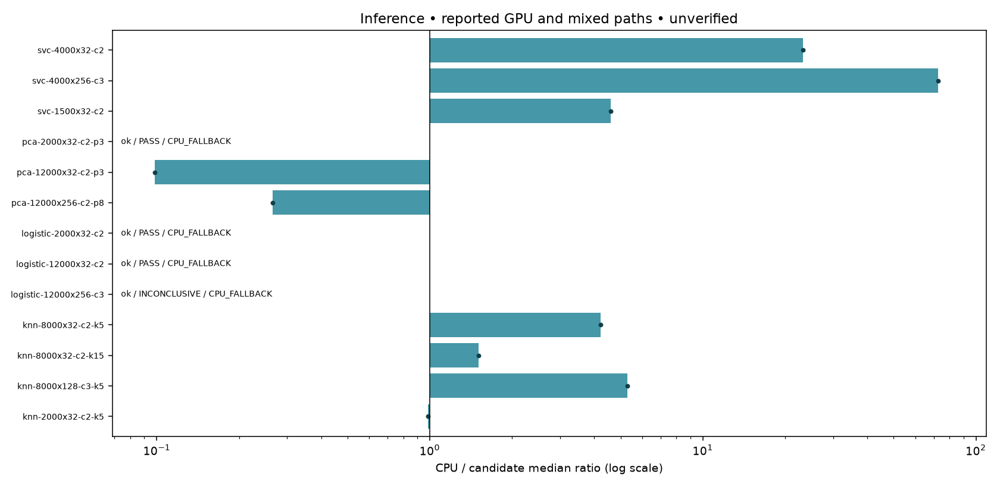
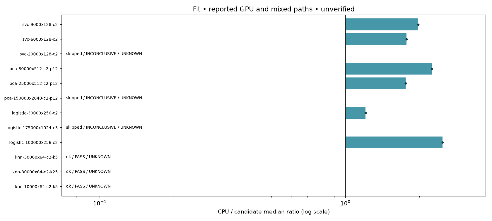

# Verified local measurement record

Measured on 2026-11-14 on macOS 27.2.1 build 26B131, Apple M5 Pro, 15 CPU cores (5 performance and 10 efficiency), 16 GPU cores, 24 GiB unified physical memory and Metal 4. The functional Metal matrix probe passed.

The locked environment used Python 3.13.18, mlx-learn 0.1.2, MLX/MLX Metal 0.32.4, scikit-learn 1.9.1, NumPy 2.5.4, SciPy 1.18.1 and Streamlit 1.67.0. NumPy/SciPy use Accelerate. Four CPU threads were requested. Discovered OpenMP pools reported four threads. Exact Accelerate utilization was unmeasured.

Canonical measurements reference clean implementation commit 2da33001222d0f6faf649a0512c71735d966b9e8. Each run was serial and completed before the next began. Exported evidence redacts machine-specific user and temporary paths.

## Canonical runs

| Profile | Run | Wall seconds | Candidate steady comparisons | Skipped cases |
|---|---|---:|---|---:|
| quick | [20261114T184301042242Z-91f4118508](evidence/20261114T184301042242Z-91f4118508/summary.md) | 6.25 | 4 PASS | 0 |
| standard | [20261114T184308448033Z-84f22b8ebf](evidence/20261114T184308448033Z-84f22b8ebf/summary.md) | 24.84 | 36 PASS, 3 INCONCLUSIVE | 0 |
| full | [20261114T184334529634Z-661130fd99](evidence/20261114T184334529634Z-661130fd99/summary.md) | 38.34 | 45 PASS | 3 |

Quick has one steady repetition per case. Standard has three. Full has five. First-call and warmup records are separate. Standard passed 12 of 13 cases across steady repeats. Full executed nine cases and skipped three. No measured case produced a numerical FAIL.

## Representative steady medians

Dataset sizes are total samples before the 75/25 split. Ratios compare the four-thread CPU baseline with a reported GPU or mixed candidate. The marked operations have independent Metal evidence from separate matching replays. Original timing rows retain the evidence available during measurement.

| Case | Operation | CPU ms | Candidate ms | CPU/candidate | Evidence | Correctness |
|---|---|---:|---:|---:|---|---|
| logistic-2000x32-c2 | fit | 1.156 | 5.023 | 0.23 | [Verified GPU work in matched fit](evidence/metal-logistic/README.md) | PASS |
| logistic-2000x32-c2 | predict | 0.058 | 0.126 | ineligible | [CPU path corroborated by trace](evidence/metal-logistic/README.md) | PASS |
| knn-2000x32-c2-k5 | fit | 0.164 | 0.231 | ineligible | UNKNOWN | PASS |
| knn-2000x32-c2-k5 | predict | 1.014 | 1.032 | 0.98 | GPU_REPORTED_UNVERIFIED | PASS |
| knn-8000x128-c3-k5 | fit | 0.535 | 0.496 | ineligible | [No Metal submissions in matched fit](evidence/metal-knn-fit/README.md) | PASS |
| knn-8000x128-c3-k5 | predict | 12.784 | 2.420 | 5.28 | [GPU_VERIFIED in matched replay](evidence/metal-knn-8000x128-c3-k5/README.md) | PASS |
| svc-4000x256-c3 | fit | 348.609 | 34.218 | 10.19 | [Verified GPU work in mixed replay](evidence/metal-svc-pca/README.md) | PASS |
| svc-4000x256-c3 | predict | 164.797 | 2.270 | 72.59 | [Verified GPU work in mixed replay](evidence/metal-svc-pca/README.md) | PASS |
| pca-12000x256-c2-p8 | fit | 4.053 | 4.135 | 0.98 | [Verified GPU work in mixed replay](evidence/metal-svc-pca/README.md) | PASS |
| pca-12000x256-c2-p8 | transform | 0.208 | 0.783 | 0.27 | [GPU_VERIFIED in matched replay](evidence/metal-svc-pca/README.md) | PASS |
| logistic-100000x256-c2 | fit | 42.453 | 17.093 | 2.48 | [Verified GPU work in matched fit](evidence/metal-logistic/README.md) | PASS |
| logistic-100000x256-c2 | predict | 0.974 | 1.774 | ineligible | [CPU path corroborated by trace](evidence/metal-logistic/README.md) | PASS |
| knn-30000x64-c2-k5 | fit | 0.723 | 0.717 | ineligible | [No Metal submissions in matched fit](evidence/metal-knn-fit/README.md) | PASS |
| knn-30000x64-c2-k5 | predict | 110.976 | 14.335 | 7.74 | [GPU_VERIFIED in matched replay](evidence/metal-knn-fit/README.md) | PASS |
| pca-80000x512-c2-p12 | fit | 30.649 | 13.672 | 2.24 | MIXED_CPU_GPU_REPORTED | PASS |
| pca-80000x512-c2-p12 | transform | 2.256 | 1.220 | 1.85 | GPU_REPORTED_UNVERIFIED | PASS |

Both gains and regressions occurred. Small logistic fits and PCA transforms often favored CPU. KNN query gains grew with sample count on the tested panel. SVC results describe mixed kernel/host-optimizer execution. The two traced KNN fit and index-construction replays had zero Metal submissions. Fit remains ratio-ineligible.

## Uninstrumented automatic versus forced timing

The seven traced workloads were timed in four balanced blocks, with five steady repetitions per implementation per block and a fresh scikit-learn control in each block. All 140 steady timing pairs passed. Automatic KNN predictions took 1.99 ms and 15.18 ms, close to forced MLX at 2.00 ms and 14.91 ms. On SVC, auto CPU prediction took 3.60 ms versus 166.06 ms for its scikit-learn control. Forced MLX took 2.36 ms. On the larger logistic workload, forced fit took 17.78 ms versus 43.39 ms in auto. Automatic PCA was faster than forced MLX for both tested shapes. [Full fit and inference table, raw data, and reproduction commands](evidence/routing-timing/README.md)

## Automatic selection versus forced MLX

Automatic selection kept both KNN first queries on the GPU. It routed both logistic fits, SVC fit and prediction, and both PCA fits and transforms to CPU. Logistic prediction already used CPU in forced mode. The smaller PCA transform also used CPU in both modes. All seven matched replays passed numerical checks.

| Workload | Forced fit / inference GPU buffers | Auto fit / inference GPU buffers |
|---|---:|---:|
| KNN 8,000 × 128 | 0 / 1 | 0 / 1 |
| KNN 30,000 × 64 | 0 / 7 | 0 / 7 |
| Logistic 2,000 × 32 | 14 / 0 | 0 / 0 |
| Logistic 100,000 × 256 | 18 / 0 | 0 / 0 |
| SVC 4,000 × 256 | 4 / 1 | 0 / 0 |
| PCA 12,000 × 256 | 3 / 2 | 0 / 0 |
| PCA 2,000 × 32 | 3 / 0 | 0 / 0 |

The original performance table remains the forced-MLX timing panel. The auto replays were instrumented to verify routing. [Routing events, Metal traces, and crossover details](evidence/metal-auto/README.md)

## KNN fit and index construction

No Metal command buffers were submitted during fit for the 8,000 × 128 and 30,000 × 64 workloads. The first predictions on those fresh models completed one and seven GPU buffers, respectively. Fit owns and stages the training arrays. Search and any lazy query preparation are measured with prediction. All observed labels matched scikit-learn. [Fit traces, first-query traces, and controls](evidence/metal-knn-fit/README.md)

## Logistic regression Metal verification

The 2,000 × 32 and 100,000 × 256 fits completed 14 and 18 Metal command buffers, respectively. Both prediction windows and all scikit-learn controls recorded zero submissions. All test labels agreed with scikit-learn on both replays. The verified GPU work applies to fit. The prediction evidence corroborates the host path. [Completion traces, controls, and capture metadata](evidence/metal-logistic/README.md)

## SVC and PCA Metal verification

The SVC fit and prediction replays completed four and one Metal command buffers, respectively. The larger PCA fit and transform completed three and two. The smaller PCA fit completed three, while its transform completed zero, consistent with CPU routing. All three replays passed numerical checks. [Completion traces, controls, and capture metadata](evidence/metal-svc-pca/README.md)

## Correctness and reliability findings

The standard logistic-12000x256-c3 candidate repeatedly reported line-search-failure at 30 iterations, gradient 2.14e-5 against tolerance 1e-5. CPU converged in 21 iterations. Label agreement was 0.99967, test accuracies were 0.84733 and 0.84700, probability MAE was about 8.14e-5 and maximum difference was about 8.54e-4. The case remains INCONCLUSIVE and has no ratio. The requested tolerance was retained.

Classification checks, SVC decision comparisons, PCA reconstruction/retained variance/principal-angle checks and candidate repeatability checks passed for the other measured cases. The full raw comparison metrics are in each measurements.json evidence file.

Full skipped logistic-175000x1024-c3 and pca-150000x2048-c2-p12 because the working-set estimate exceeded the live memory budget. It skipped svc-20000x128-c2 at the SVC quadratic-work ceiling. Requested shapes and reasons are preserved.

## CPU thread sensitivity

Separate serial CPU-only sweeps reused four standard workloads with one warmup and three steady repeats at requested thread ceilings 1, 4 and 15. Paired cross-library correctness is INCONCLUSIVE in those CPU-only runs. Workload fingerprints match the paired experiments. SVC uses a single-threaded LIBSVM solver, so larger thread ceilings do not imply parallel fit.

| Workload | Threads | Fit ms | Inference ms |
|---|---:|---:|---:|
| logistic-12000x32-c2 | 1 | 2.551 | 0.080 |
| knn-8000x32-c2-k5 | 1 | 0.281 | 24.343 |
| svc-4000x256-c3 | 1 | 351.892 | 167.512 |
| pca-12000x256-c2-p8 | 1 | 4.012 | 0.207 |
| logistic-12000x32-c2 | 4 | 2.565 | 0.082 |
| knn-8000x32-c2-k5 | 4 | 0.295 | 8.484 |
| svc-4000x256-c3 | 4 | 355.519 | 168.524 |
| pca-12000x256-c2-p8 | 4 | 4.065 | 0.225 |
| logistic-12000x32-c2 | 15 | 2.637 | 0.083 |
| knn-8000x32-c2-k5 | 15 | 0.308 | 6.559 |
| svc-4000x256-c3 | 15 | 357.883 | 168.911 |
| pca-12000x256-c2-p8 | 15 | 4.017 | 0.206 |

Four threads remains the preselected paired baseline. Timing variability across these small sweeps limits claims about optimal thread count. Accelerate scheduling and background activity remain uncontrolled.

## Charts

Standard inference ratios include ineligible and inconclusive cases with explicit labels.

Full fit ratios retain workload-admission skips.

## Reproduce

Run uv sync --locked --extra dashboard, then mlx-m5-bench doctor, mlx-m5-bench run --profile quick, --profile standard and --profile full through uv run. The packaged profiles and committed lock specify the inputs and dependencies. Every run writes fresh timings. Independent traces for other workloads remain open.
